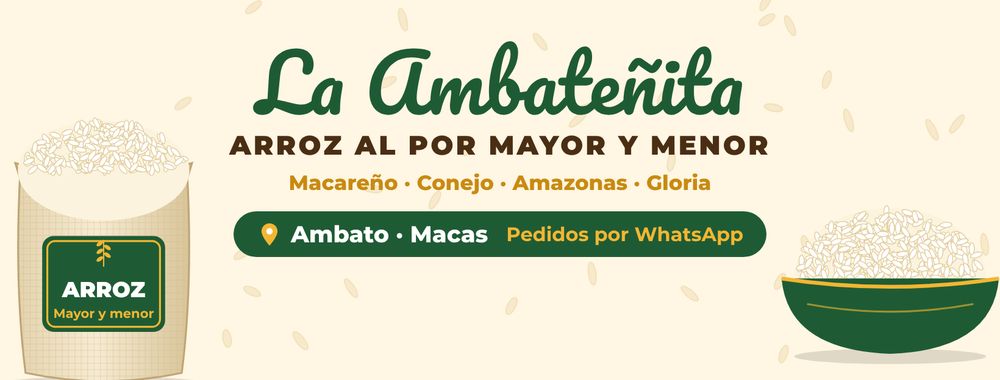
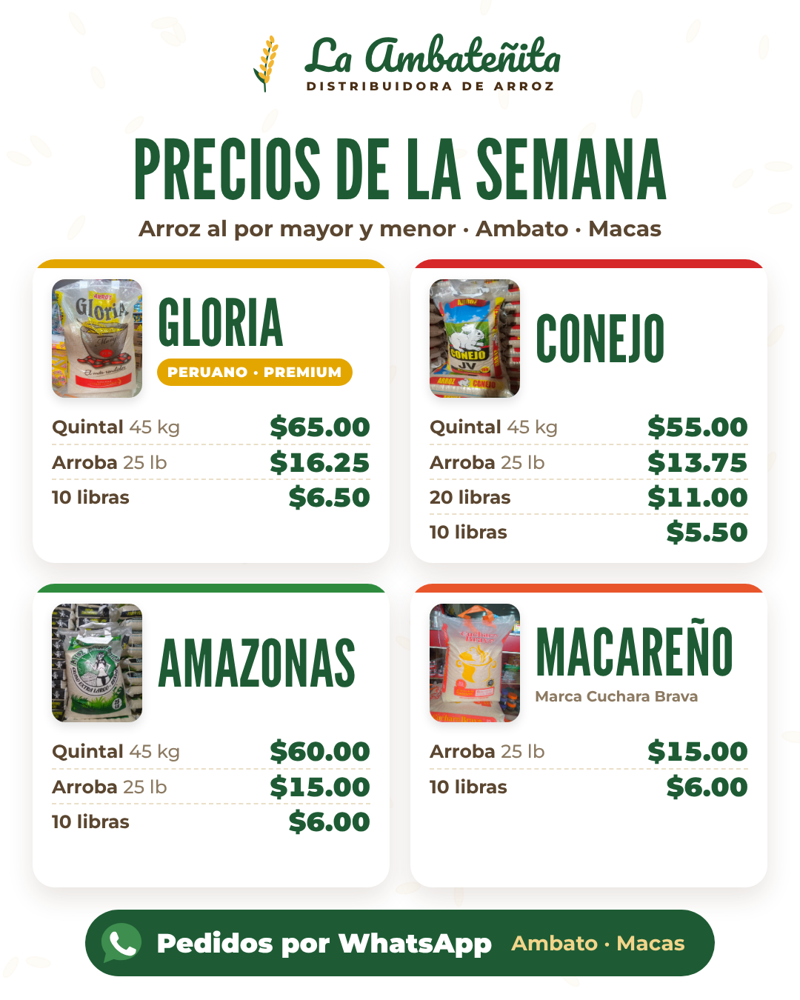
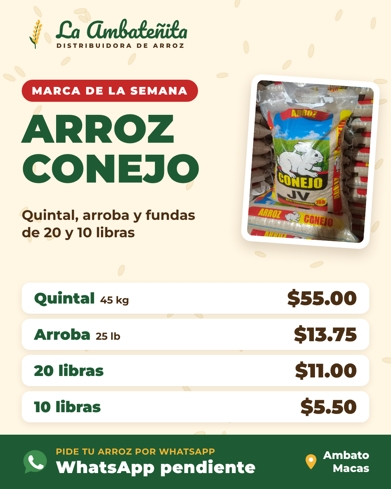
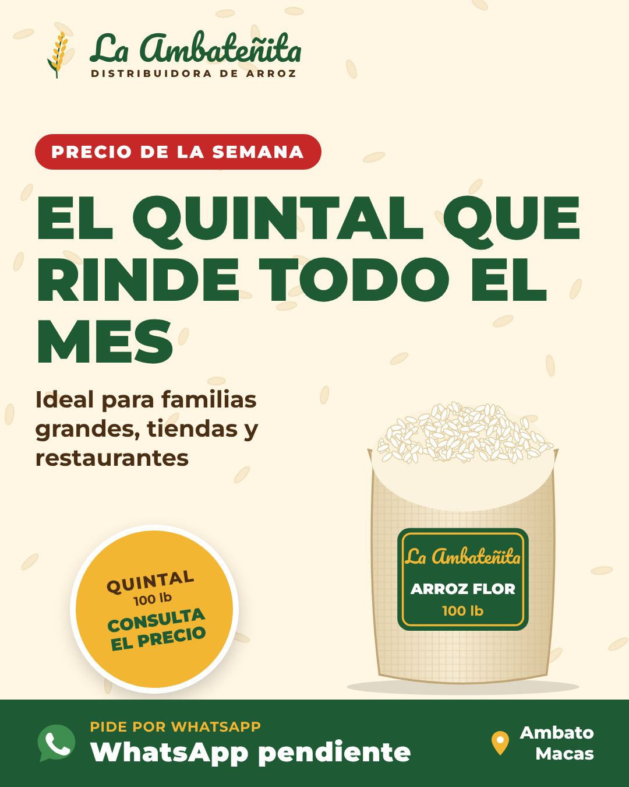

# La Ambateñita 🌾 Distribuidora de arroz

Página de Facebook y contenido automático para **La Ambateñita**: distribuidora de arroz al por mayor y menor en **Ambato** y **Macas**. Marcas: **Macareño, Conejo, Amazonas y Gloria**.

Claude genera cada día una foto o un video con la marca, escribe el texto y lo deja programado en Metricool, que lo publica solo en Facebook.



| Todos los precios | Marca de la semana | Precio | Reel animado |
|---|---|---|---|
|  |  |  |  |

**Catálogo de productos para tiendas (PDF):** [`catalogo/Catalogo-La-Ambatenita.pdf`](catalogo/Catalogo-La-Ambatenita.pdf), con 226 productos, precios y códigos para pedir por WhatsApp. Más detalles en [docs/5-catalogo-de-productos.md](docs/5-catalogo-de-productos.md).

Reel de presentación animado: [`media/reels/reel-presentacion.mp4`](media/reels/reel-presentacion.mp4) (proyecto editable en `videos/reel-presentacion/`). Reels automáticos de ejemplo: [`media/muestras/reel-precios.mp4`](media/muestras/reel-precios.mp4).

## Pasos para arrancar

1. **Crea la página de Facebook**: [docs/1-crear-pagina-facebook.md](docs/1-crear-pagina-facebook.md). Usa la foto de perfil y la portada de `media/marca/`.
2. **Completa tus datos** en [`config/negocio.json`](config/negocio.json) o díselos a Claude por chat:
   - número de WhatsApp (**obligatorio**)
   - ~~marcas y precios~~ ✅ ya cargados desde tu catálogo (avisa cuando cambien)
   - direcciones en Ambato y en Macas, y horario
   - si haces entregas a domicilio y en qué sectores
3. **Conecta la página a Metricool**: [docs/2-conectar-metricool.md](docs/2-conectar-metricool.md)
4. **Envía fotos y videos reales** de tu bodega, tus sacos y tus entregas: son lo que más vende.
5. Claude genera la semana, la programa y deja una rutina semanal automática.

## Documentación

- [1. Crear la página de Facebook](docs/1-crear-pagina-facebook.md)
- [2. Conectar Metricool](docs/2-conectar-metricool.md)
- [3. Estrategia para ganar mercado](docs/3-estrategia-para-ganar-mercado.md)
- [4. Cómo funciona la automatización](docs/4-como-funciona-la-automatizacion.md)
- [5. Catálogo de productos (PDF)](docs/5-catalogo-de-productos.md)

## Estructura

```
config/negocio.json        datos del negocio, precios y horarios de publicación
contenido/calendario.json  28 días de contenido (se repite en ciclo)
scripts/generar.mjs        genera imágenes y reels
scripts/lib/               marca (colores, fuentes, ilustraciones), plantillas y render
marca/fuentes/             tipografías Pacifico y Montserrat (licencia OFL)
fotos/                     tus fotos y videos reales
fotos/catalogo/            foto de cada saco por marca y presentación
media/marca/               foto de perfil y portada de Facebook
media/muestras/            ejemplos de cada diseño
media/AAAA-MM-DD/          publicación de cada día (imagen o reel + publicacion.json)
catalogo/                  catálogo de productos: productos.json, fotos, PDF y páginas en JPG
scripts/catalogo.mjs       genera el PDF del catálogo
```
